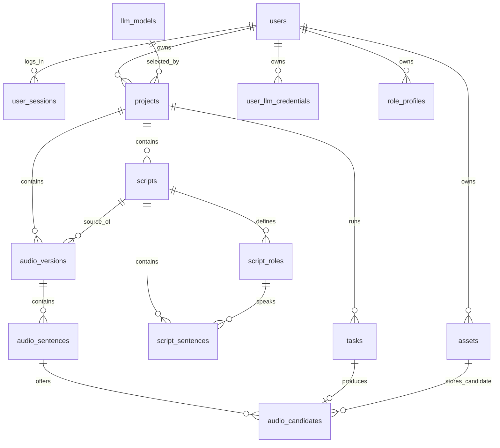

# 文字转播客系统数据库设计

本文依据当前六个业务模块编写，供数据库建表、ORM 开发和接口联调使用。采用 MySQL、InnoDB 和 `utf8mb4`，以外键组织用户、项目、脚本、音频和任务。

## 1 业务规则

| 项目 | 本文采用的规则 |
| --- | --- |
| 原文 | 直接保存在项目表，不建立原文版本表。首次确认提交或 TXT 上传成功后锁定，不再修改或替换；需要换原文时创建新项目 |
| 脚本版本 | 每次调用 LLM 成功生成脚本时新增版本；手动保存修改直接更新该版的角色和句子，不增加展示版本号 |
| 脚本修订 | 增加内部 `edit_revision`，手动有效修改时递增，用于并发校验和快照对应，不作为新的脚本版本展示 |
| 脚本确认 | 同一项目最多有一版处于 `confirmed`；确认其他版本前先取消原确认；已确认脚本禁止修改 |
| 试听 | 使用已确认脚本的前三句，不足三句使用全部；保存任务快照和试听资产，不创建正式音频版本 |
| 完整音频 | 每次完整生成创建一个新的项目级音频版本，保存脚本与声音配置快照，逐句合成后自动合并 MP3 |
| 单句重生成 | 在指定音频版本下生成候选片段，用户选择前保留原结果；选择成功后更新该版本的当前片段和完整 MP3，不增加音频版本号 |
| 覆盖范围 | 数据库覆盖的是当前选用片段与成品的引用，不覆盖原文件字节。新文件使用新对象键，失败不会破坏原成品 |
| 历史查询 | 展示各次 LLM 生成的脚本版本及其最新人工编辑内容、各次完整生成的音频版本；不提供每次人工编辑的历史回滚 |

原文规则存在一处冲突：模块说明要求“提交后不可修改”，补充说明第 3 条又描述“修改时直接覆盖”。本文优先采用前者，因此不设置 `source_version`，提交后的原文更新由服务端拒绝。若后续明确允许修改，可沿用项目正文列，但生成任务仍须保存原文快照。

“脚本版本”和“音频版本”均在项目内独立编号。脚本 V2 可以生成音频 V3、V4，编号不要求相同。`edit_revision` 和音频的 `selection_revision` 仅用于内部一致性校验。

## 2 公共字段约定

- 主键 `id` 使用后端生成的 UUID，类型为 `CHAR(36)`；所有外键 ID 使用相同类型与排序规则。
- 所有表都有 `created_at DATETIME(3) NOT NULL`、`updated_at DATETIME(3) NOT NULL`，按 UTC 保存；字段表不重复列出。
- 下表“必填”指数据库非空；生成过程尚未取得的结果字段允许为空。
- 状态使用 `VARCHAR` 保存，允许值通过数据库 `CHECK` 和应用 Schema 校验，不接受任意字符串。
- 模型参数、角色声音配置和快照使用经过 Schema 校验的 `JSON`；需要外键或查询索引的数据单独建列，不只藏在 JSON 中。
- 数据库只存文件元数据与受控对象键，TXT、片段、试听及完整 MP3 放在文件存储中。
- 外键默认采用 `RESTRICT`，当前不开放物理级联删除项目。用户、模型、角色和凭据优先禁用或逻辑删除；资源清理单独执行。

## 3 表结构总览

| 模块 | 表名 | 作用 |
| --- | --- | --- |
| 用户 | `users` | 用户账户 |
| 用户 | `user_sessions` | 登录会话与退出撤销 |
| 配置 | `llm_models` | 已接入的提供方与模型目录 |
| 配置 | `user_llm_credentials` | 用户自己的提供方 API 密钥 |
| 配置 | `role_profiles` | 用户可复用的角色与声音配置 |
| 项目 | `projects` | 项目、原文及所选 LLM 配置 |
| 脚本 | `scripts` | 每次生成的脚本版本及确认状态 |
| 脚本 | `script_roles` | 某版脚本实际使用的角色与声音配置 |
| 脚本 | `script_sentences` | 有序台词、角色和句子级参数 |
| 任务 | `tasks` | 脚本与音频操作的异步执行记录 |
| 资源 | `assets` | 原文文件、试听、片段和完整 MP3 元数据 |
| 语音 | `audio_versions` | 正式音频版本及当前成品 |
| 语音 | `audio_sentences` | 某音频版本的分句快照与当前片段 |
| 语音 | `audio_candidates` | 单句重生成产生的候选结果及用户选择 |

## 4 用户与配置表

### 4.1 users 用户

| 字段 | 类型 | 必填 | 说明 |
| --- | --- | --- | --- |
| `id` | CHAR(36) | 是 | 主键 |
| `username` | VARCHAR(64) | 是 | 规范化后的登录名，唯一 |
| `password_hash` | VARCHAR(255) | 是 | 密码散列，不保存明文密码 |
| `display_name` | VARCHAR(100) | 否 | 昵称                     |
| `status` | VARCHAR(16) | 是 | `active`、`disabled` |

约束与索引：`UNIQUE(username)`。用户名的大小写与空白规则在注册、登录时统一处理。

### 4.2 user_sessions 登录会话

| 字段 | 类型 | 必填 | 说明 |
| --- | --- | --- | --- |
| `id` | CHAR(36) | 是 | 主键 |
| `user_id` | CHAR(36) | 是 | 外键 → `users.id` |
| `token_hash` | CHAR(64) | 是 | 随机会话凭据的摘要，唯一；原凭据只交给客户端 |
| `expires_at` | DATETIME(3) | 是 | 过期时间 |
| `revoked_at` | DATETIME(3) | 否 | 登出时填写，立即失效 |

索引：`UNIQUE(token_hash)`、`INDEX(user_id, expires_at)`。鉴权同时检查用户启用状态、会话过期和撤销状态。

### 4.3 llm_models 模型目录

| 字段 | 类型 | 必填 | 说明 |
| --- | --- | --- | --- |
| `id` | CHAR(36) | 是 | 主键 |
| `provider_code` | VARCHAR(64) | 是 | 后端支持的提供方标识，如 `deepseek`、`local` |
| `model_code` | VARCHAR(128) | 是 | 提供方实际模型标识 |
| `name` | VARCHAR(100) | 是 | 前端展示名称 |
| `base_url` | VARCHAR(512) | 是 | 后端维护的受控地址，普通用户不能任意修改 |
| `adapter_code` | VARCHAR(64) | 是 | 调用该服务的适配器类型 |
| `platform_secret_ref` | VARCHAR(255) | 否 | 平台密钥的安全配置引用，不是密钥原文 |
| `supports_user_key` | BOOLEAN | 是 | 是否允许使用用户自己的密钥 |
| `default_params` | JSON | 是 | 默认生成参数，不含密钥 |
| `status` | VARCHAR(16) | 是 | `enabled`、`disabled` |

约束与索引：`UNIQUE(provider_code, base_url, model_code)`。实际建唯一索引时需核对组合键字节长度；也可使用后端生成的唯一目录编码代替长地址组合索引。首期目录中的模型由配置或初始化脚本维护。

### 4.4 user_llm_credentials 用户密钥

| 字段 | 类型 | 必填 | 说明 |
| --- | --- | --- | --- |
| `id` | CHAR(36) | 是 | 主键 |
| `user_id` | CHAR(36) | 是 | 外键 → `users.id` |
| `provider_code` | VARCHAR(64) | 是 | 适用的已接入提供方 |
| `name` | VARCHAR(100) | 是 | 凭据别名 |
| `encrypted_secret` | TEXT | 是 | 使用认证加密保存的密文；格式包含所需 nonce 和认证标签 |
| `key_version` | VARCHAR(64) | 是 | 加密密钥版本／引用，解密密钥存放于数据库之外 |
| `masked_value` | VARCHAR(64) | 是 | 供界面显示的掩码，不保存完整明文 |
| `status` | VARCHAR(16) | 是 | `enabled`、`disabled`、`deleted` |

索引：`INDEX(user_id, provider_code, status)`。任务只保存凭据 ID，不复制密文或明文到快照。新增任务检查凭据所有者及提供方匹配；凭据不可用时失败提示，不自动改用平台密钥扣费。

### 4.5 role_profiles 角色配置模板

| 字段 | 类型 | 必填 | 说明 |
| --- | --- | --- | --- |
| `id` | CHAR(36) | 是 | 主键 |
| `user_id` | CHAR(36) | 是 | 外键 → `users.id` |
| `name` | VARCHAR(100) | 是 | 角色名称，如主持人、嘉宾 |
| `description` | TEXT | 否 | 人设和表达说明 |
| `tts_provider` | VARCHAR(64) | 是 | 已接入 TTS 提供方 |
| `tts_model` | VARCHAR(128) | 是 | 模型标识 |
| `voice_id` | VARCHAR(128) | 是 | 提供方适配器认可的音色标识 |
| `style` | VARCHAR(64) | 否 | 服务实际支持的风格 |
| `speed` | DECIMAL(5,2) | 是 | 默认 1.00，具体有效范围按 TTS 能力校验 |
| `extra_params` | JSON | 是 | 其他已支持参数，默认 `{}` |
| `status` | VARCHAR(16) | 是 | `enabled`、`disabled`、`deleted` |

索引：`INDEX(user_id, status)`。角色模板可以修改，但修改不自动覆盖已生成脚本中的角色和已创建音频任务。

## 5 项目与脚本表

### 5.1 projects 项目与原文

| 字段 | 类型 | 必填 | 说明 |
| --- | --- | --- | --- |
| `id` | CHAR(36) | 是 | 主键 |
| `user_id` | CHAR(36) | 是 | 外键 → `users.id` |
| `title` | VARCHAR(100) | 是 | 项目标题 |
| `source_text` | MEDIUMTEXT | 否 | 用户已提交的原文；空项目时为 NULL |
| `source_type` | VARCHAR(16) | 否 | `text`、`txt`，未提交时为 NULL |
| `source_asset_id` | CHAR(36) | 否 | 外键 → `assets.id`，可选保留上传 TXT |
| `source_hash` | CHAR(64) | 否 | 已保存原文摘要 |
| `source_submitted_at` | DATETIME(3) | 否 | 非空表示原文已提交且锁定 |
| `llm_model_id` | CHAR(36) | 否 | 外键 → `llm_models.id`，生成前必须选定有效模型 |
| `credential_source` | VARCHAR(16) | 是 | `platform`、`user`，默认 `platform` |
| `llm_credential_id` | CHAR(36) | 否 | 外键 → `user_llm_credentials.id`；选择用户密钥时必填 |
| `llm_params` | JSON | 是 | 当前项目的生成参数，默认 `{}` |
| `current_script_id` | CHAR(36) | 否 | 外键 → `scripts.id`，当前默认展示脚本；不表示它已确认 |

索引：`INDEX(user_id, created_at)`。原文确认提交时锁定项目行，检查 `source_submitted_at IS NULL` 后一次性写入正文、来源、摘要和时间，重复替换应拒绝。项目当前脚本指向必须属于本项目。

### 5.2 scripts 脚本生成版本

| 字段 | 类型 | 必填 | 说明 |
| --- | --- | --- | --- |
| `id` | CHAR(36) | 是 | 主键 |
| `project_id` | CHAR(36) | 是 | 外键 → `projects.id` |
| `version` | INT UNSIGNED | 是 | 项目内生成版本，从 1 开始，手动修改不变 |
| `edit_revision` | INT UNSIGNED | 是 | 内部修订号，初始 1，每次有效保存修改递增 |
| `title` | VARCHAR(100) | 是 | 脚本标题 |
| `summary` | TEXT | 否 | 简介 |
| `status` | VARCHAR(24) | 是 | `draft`、`confirmed`，默认 `draft` |
| `llm_snapshot` | JSON | 是 | 生成时的模型、有效参数、Prompt 及原文摘要等，不含密钥 |
| `confirmed_at` | DATETIME(3) | 否 | 当前确认时间，取消确认后置空 |
| `confirmed_by` | CHAR(36) | 否 | 外键 → `users.id`，取消确认后置空 |
| `confirmed_revision` | INT UNSIGNED | 否 | 当前确认的 `edit_revision`，取消确认后置空 |
| `confirmed_project_key` | CHAR(36) | 否 | 生成列：已确认时取 `project_id`，否则 NULL，用于唯一约束 |

约束：`UNIQUE(project_id, version)`、`UNIQUE(confirmed_project_key)`。状态为 confirmed 时，确认人、时间和修订号必须齐全，且 `confirmed_revision = edit_revision`。

同项目唯一确认可使用以下约束，实际迁移中在表建立后添加：

```sql
ALTER TABLE scripts
  ADD COLUMN confirmed_project_key CHAR(36)
    GENERATED ALWAYS AS (
      CASE WHEN status = 'confirmed' THEN project_id ELSE NULL END
    ) STORED,
  ADD UNIQUE KEY uq_scripts_confirmed_project (confirmed_project_key);
```

这是生成列，不由 API 或 ORM 手动赋值。已定义该列的建表语句不应重复运行上述 ALTER。MySQL 唯一索引允许多个 NULL，结合生成列可限制每个项目最多一条 confirmed；确认操作仍需事务校验。参见 [生成列](https://dev.mysql.com/doc/refman/8.4/en/create-table-generated-columns.html)与[唯一索引](https://dev.mysql.com/doc/refman/8.4/en/create-index.html)。

### 5.3 script_roles 脚本实际角色

| 字段 | 类型 | 必填 | 说明 |
| --- | --- | --- | --- |
| `id` | CHAR(36) | 是 | 主键 |
| `script_id` | CHAR(36) | 是 | 外键 → `scripts.id` |
| `profile_id` | CHAR(36) | 否 | 外键 → `role_profiles.id`，角色来源模板 |
| `role_key` | VARCHAR(64) | 是 | 脚本内角色标识，如 `host`、`guest` |
| `name` | VARCHAR(100) | 是 | 本脚本中的角色名称 |
| `description` | TEXT | 否 | 本脚本中的角色说明 |
| `voice_config` | JSON | 是 | 从模板复制的 TTS 提供方、模型、音色、风格、默认语速及参数 |

约束：`UNIQUE(script_id, role_key)`，并建立 `UNIQUE(script_id, id)` 供组合外键引用。模板是可复用配置，此表是实际脚本数据；后续模板变化不自动改此表。修改此表同样受脚本确认锁定和内部修订控制。

### 5.4 script_sentences 脚本句

| 字段 | 类型 | 必填 | 说明 |
| --- | --- | --- | --- |
| `id` | CHAR(36) | 是 | 主键；手动修改同一句不改变 ID |
| `script_id` | CHAR(36) | 是 | 外键 → `scripts.id` |
| `sequence` | INT UNSIGNED | 是 | 脚本内顺序，从 1 开始，连续且唯一 |
| `role_id` | CHAR(36) | 是 | 对应本脚本的 `script_roles.id` |
| `text` | TEXT | 是 | 非空台词 |
| `speed` | DECIMAL(5,2) | 否 | 句子级覆盖值；NULL 时使用该脚本角色的默认语速 |
| `extra_params` | JSON | 是 | 句子级、经过能力校验的覆盖参数，默认 `{}` |

约束：`UNIQUE(script_id, sequence)`；组合外键 `(script_id, role_id) → script_roles(script_id, id)`，防止引用其他脚本的角色。首次生成或重新生成均创建新的脚本和句子 ID，不跨生成版本强行对齐句子。

手动保存修改先锁定脚本行，检查 `status = draft` 和 `expected_edit_revision`，再更新句子／角色并递增脚本 `edit_revision`。只维护整份脚本的内部修订号，不增加独立句子修订号；无实际修改不递增。响应返回新的内部修订号。

## 6 任务与文件表

### 6.1 tasks 异步任务

| 字段 | 类型 | 必填 | 说明 |
| --- | --- | --- | --- |
| `id` | CHAR(36) | 是 | 主键，供前端轮询 |
| `user_id` | CHAR(36) | 是 | 外键 → `users.id`，发起者 |
| `project_id` | CHAR(36) | 是 | 外键 → `projects.id` |
| `task_type` | VARCHAR(16) | 是 | `script`、`audio` |
| `audio_action` | VARCHAR(16) | 否 | 音频任务为 `preview`、`full`、`regenerate`；脚本任务为 NULL |
| `script_id` | CHAR(36) | 否 | 外键 → `scripts.id`；脚本生成成功后填结果脚本，音频任务提交时填来源脚本 |
| `audio_version_id` | CHAR(36) | 否 | 外键 → `audio_versions.id`；full 和 regenerate 必填，preview 为空 |
| `audio_sentence_id` | CHAR(36) | 否 | 外键 → `audio_sentences.id`；单句重生成时必填 |
| `credential_id` | CHAR(36) | 否 | 外键 → `user_llm_credentials.id`；使用用户密钥的脚本任务填写 |
| `retry_of_task_id` | CHAR(36) | 否 | 自外键 → `tasks.id`；重试时创建新任务并关联上一次 |
| `status` | VARCHAR(16) | 是 | `queued`、`running`、`succeeded`、`failed` |
| `stage` | VARCHAR(32) | 是 | 当前步骤，如 `calling_llm`、`synthesizing`、`merging` |
| `progress` | TINYINT UNSIGNED | 否 | 0—100；无法准确计算时为空，改为展示阶段 |
| `total_sentences` | INT UNSIGNED | 是 | 默认 0，音频任务按实际句数填写 |
| `completed_sentences` | INT UNSIGNED | 是 | 默认 0 |
| `failed_sentences` | INT UNSIGNED | 是 | 默认 0 |
| `input_snapshot` | JSON | 是 | 完整的受理输入和有效配置，不含明文或密文密钥 |
| `result_json` | JSON | 否 | 成功结果，如脚本 ID、试听资产、候选 ID 或完整音频版本 ID |
| `result_asset_id` | CHAR(36) | 否 | 外键 → `assets.id`；当前任务实际产生的音频结果，不随后续选择改变 |
| `error_code` | VARCHAR(64) | 否 | 脱敏业务错误码 |
| `error_message` | VARCHAR(1000) | 否 | 可展示错误原因 |
| `idempotency_key` | VARCHAR(128) | 否 | 用户范围内请求幂等键 |
| `request_hash` | CHAR(64) | 是 | 请求摘要，用于区分同键不同输入 |
| `started_at` / `finished_at` | DATETIME(3) | 否 | 起止时间，两个独立字段 |
| `heartbeat_at` | DATETIME(3) | 否 | Worker 存活检查 |
| `lease_token` | CHAR(36) | 否 | 执行领取令牌，阻止失联旧 Worker 回写 |

约束与索引：`UNIQUE(user_id, idempotency_key)`、`INDEX(project_id, created_at)`、`INDEX(status, updated_at)`、`INDEX(audio_version_id, created_at)`。同一用户同幂等键同请求返回原任务，不同请求拒绝。未提供幂等键时为空，不使用空字符串代替 NULL。

重试采用新任务 ID，不覆盖旧失败记录：脚本重试成功才生成新脚本；完整音频失败后的重试沿用该次已分配的音频版本，复用已校验片段，不重新分配版本号。用户主动再次点击“完整生成”才创建新的音频版本。

### 6.2 assets 文件资产

| 字段 | 类型 | 必填 | 说明 |
| --- | --- | --- | --- |
| `id` | CHAR(36) | 是 | 主键 |
| `user_id` | CHAR(36) | 是 | 外键 → `users.id` |
| `kind` | VARCHAR(24) | 是 | `source_txt`、`preview`、`segment`、`full_audio` |
| `storage_backend` | VARCHAR(32) | 是 | 如 `local`、`s3` |
| `object_key` | VARCHAR(512) | 是 | 服务端生成的受控对象键，不是客户端传入路径 |
| `original_name` | VARCHAR(255) | 否 | 上传文件名或安全下载名 |
| `mime_type` | VARCHAR(100) | 是 | 如 `text/plain`、`audio/mpeg` |
| `size_bytes` | BIGINT UNSIGNED | 是 | 文件大小 |
| `duration_ms` | BIGINT UNSIGNED | 否 | 音频时长，TXT 为空 |
| `sha256` | CHAR(64) | 是 | 文件摘要 |
| `metadata_json` | JSON | 是 | 音频规格；完整 MP3 保存生成时的有序片段清单和有效参数 |
| `status` | VARCHAR(16) | 是 | `ready`、`deleted`；仅校验、存储完成后登记为 ready |

约束：`UNIQUE(storage_backend, object_key)`。下载先根据资产及其业务关联鉴权，不能以知道对象键或文件名作为访问权限。URL 按需生成，不永久保存带过期签名的 URL。

## 7 正式音频与候选表

### 7.1 audio_versions 正式音频版本

| 字段 | 类型 | 必填 | 说明 |
| --- | --- | --- | --- |
| `id` | CHAR(36) | 是 | 主键 |
| `project_id` | CHAR(36) | 是 | 外键 → `projects.id` |
| `script_id` | CHAR(36) | 是 | 外键 → `scripts.id`，仅用于追溯来源，不据此实时重建台词 |
| `version` | INT UNSIGNED | 是 | 项目内正式音频版本，只有主动完整生成时递增 |
| `script_edit_revision` | INT UNSIGNED | 是 | 受理时的脚本内部修订号 |
| `script_snapshot` | JSON | 是 | 不可变的脚本标题、角色、句子 ID、顺序、正文、语速及确认信息 |
| `config_snapshot` | JSON | 是 | 初次完整生成的 TTS、模型、音色、风格及有效参数，不含密钥 |
| `status` | VARCHAR(16) | 是 | 初次完整生成状态：`queued`、`running`、`ready`、`failed` |
| `selection_revision` | INT UNSIGNED | 是 | 内部选用修订号；初始 0，首次成品发布变为 1，此后每次成功替换片段并合并时递增 |
| `current_asset_id` | CHAR(36) | 否 | 外键 → `assets.id`，当前完整 MP3 |

约束与索引：`UNIQUE(project_id, version)`、`INDEX(script_id, created_at)`。完整生成受理时锁定项目行分配版本号并建立此行；失败可保留编号空缺，不回收或重排版本号。

试听不进入本表，其来源及结果保存在 tasks 中。该音频版本已 ready 后，候选生成或替换失败不把它改为 failed，旧成品继续有效；失败信息属于对应的新任务。

### 7.2 audio_sentences 音频版本的句段

| 字段 | 类型 | 必填 | 说明 |
| --- | --- | --- | --- |
| `id` | CHAR(36) | 是 | 主键，单句重生成定位此 ID |
| `audio_version_id` | CHAR(36) | 是 | 外键 → `audio_versions.id` |
| `source_sentence_id` | CHAR(36) | 是 | 外键 → `script_sentences.id`，只作为来源关联 |
| `sequence` | INT UNSIGNED | 是 | 冻结的合并顺序 |
| `text_snapshot` | TEXT | 是 | 初次完整生成时的正文，不随脚本编辑改变 |
| `role_snapshot` | JSON | 是 | 初始角色、音色、风格和有效语速 |
| `current_params` | JSON | 是 | 当前选用片段实际使用的参数；接受候选时按需更新 |
| `status` | VARCHAR(16) | 是 | 初次句段合成状态：`queued`、`running`、`succeeded`、`failed` |
| `current_asset_id` | CHAR(36) | 否 | 外键 → `assets.id`，当前选用片段 |
| `error_message` | VARCHAR(1000) | 否 | 初次片段合成失败原因 |

约束：`UNIQUE(audio_version_id, sequence)`、`UNIQUE(audio_version_id, source_sentence_id)`。后台按此表逐句生成，前端查询此表的投影获得实时进度与就绪片段；不需要前端逐句发起首次合成。

初次成功后，重生成候选不改此行状态，也不立即替换当前资产。没有选中的候选不会影响原片段、完整 MP3 或下载。

### 7.3 audio_candidates 单句重生成候选

| 字段 | 类型 | 必填 | 说明 |
| --- | --- | --- | --- |
| `id` | CHAR(36) | 是 | 主键 |
| `audio_sentence_id` | CHAR(36) | 是 | 外键 → `audio_sentences.id` |
| `task_id` | CHAR(36) | 是 | 外键 → `tasks.id`，产生该候选的任务 |
| `base_asset_id` | CHAR(36) | 是 | 外键 → `assets.id`，发起重生成时正在使用的原片段 |
| `base_selection_revision` | INT UNSIGNED | 是 | 发起时音频版本的内部选用修订号 |
| `asset_id` | CHAR(36) | 否 | 外键 → `assets.id`，候选生成成功后填写 |
| `text_snapshot` | TEXT | 是 | 候选实际朗读正文；首期必须等于目标音频句段快照 |
| `params_snapshot` | JSON | 是 | 候选实际合成参数 |
| `feedback_json` | JSON | 否 | 预留用户反馈，如自然语言、问题标签；首期不启用自动改写 |
| `status` | VARCHAR(16) | 是 | `pending`、`ready`、`accepted`、`discarded`、`failed` |
| `decided_at` | DATETIME(3) | 否 | 用户作出保留选择并完成处理的时间 |

索引：`INDEX(audio_sentence_id, created_at)`、`UNIQUE(task_id)`，首期一次重生成任务对应一个候选。`accepted` 表示曾被采用，是否当前使用以 `audio_sentences.current_asset_id` 为准。

用户保留原片段时，将新候选置为 discarded，不改变音频版本。采用新候选时，先合并并校验新完整 MP3，成功后才在事务中更新选用引用。旧文件不就地覆盖，后续仅清理不再被任务、片段、成品清单引用的文件。

## 8 表关系与外键边界



图中省略部分资产和当前指向关系；具体外键以字段表为准。建表时先建立全部表，再添加 `projects.current_script_id`、任务与音频的交叉外键，避免建表顺序造成循环依赖。

外键保证对象存在，不自动保证跨层关联正确。应用服务必须在事务中检查：

- 当前用户是项目所有者；项目凭据、角色模板及资产也属于该用户。
- `projects.current_script_id`、任务 `script_id` 和音频版本引用的脚本属于该项目。
- 音频任务的 `audio_sentence_id` 属于其 `audio_version_id`，候选所属句段与操作目标一致。
- 候选资产为同一用户的有效片段，当前完整音频资产为同一用户的有效 MP3。
- 脚本句所属角色通过组合外键约束，其他跨表范围关系可继续增加引用唯一组合键的组合外键。

索引和外键迁移应由 Alembic 统一管理，外键列建立必要索引。具体限制参见 [MySQL 外键文档](https://dev.mysql.com/doc/refman/8.4/en/create-table-foreign-keys.html)。

## 9 关键写入流程

### 9.1 生成及手动保存脚本

1. 创建脚本任务时验证原文已提交，检查模型和凭据，保存原文全文、角色输入、实际 Prompt、模型参数等快照。
2. LLM 调用在事务之外执行。响应通过结构、角色、顺序和长度校验后，再开启短事务。
3. 锁定项目行，分配下一个脚本 version，插入 scripts、script_roles 和 script_sentences，更新当前展示指向及任务成功结果。
4. 重新生成不会自动取消旧脚本确认，也不自动确认新脚本。项目“当前展示脚本”和“已确认脚本”分别查询。
5. 手动保存携带脚本 ID 和 `expected_edit_revision`；锁定该脚本并检查 draft，更新句子／角色、递增内部修订号，脚本 version 保持不变。相同脚本其他编辑和确认也锁定该行。

模型调用失败不创建半份脚本，任务保留失败原因。对同项目的脚本生成首期采用串行受理，防止迟到结果意外替换用户正在查看的结果。

### 9.2 确认和取消确认

确认请求同时携带脚本 ID、展示 version 与 `expected_edit_revision`，防止同一版本号下内容已被别人修改却确认了新内容。

事务内先锁定项目行，再锁定目标脚本行。若已有其他脚本 confirmed，拒绝并要求用户先取消确认；通过校验后写确认状态、修订号、用户和时间。取消确认将状态恢复 draft 并清空当前确认字段。

音频任务受理使用相同项目→脚本锁顺序，确认输入合法并复制快照后提交。取消确认后不能新建基于该未确认脚本的试听或完整任务，已受理任务继续使用冻结快照。

单句音频重生成针对既有音频快照，不实时读取已经取消确认或编辑后的脚本。它只重做已确认过并被冻结的旧台词，不允许借此朗读新草稿。

### 9.3 完整生成和试听

- 试听：截取确认脚本的前三句并限制总长度，写 preview 任务及快照；成功后只写试听资产和任务结果。
- 完整生成：锁定项目分配音频 version，写 audio_versions、全量 audio_sentences 及 full 任务，事务提交后投递后台执行。
- 逐句成功后保存独立资产并更新对应句段；任一句失败，父任务不能成功。失败重试创建关联任务，沿用音频版本及快照，复用可读取的成功片段。
- 全部就绪后按冻结顺序生成合并清单，校验完整 MP3 并保存资产，事务内设置 current_asset_id、selection_revision=1 和 ready，同时完成任务。
- 数据库事务不覆盖模型调用和音频合并等长时间操作。先保存、校验新文件，再登记并发布引用；未引用临时文件由清理流程处理。

### 9.4 重生成候选、选择及覆盖

1. 校验目标音频版本已有有效成品；复制目标句段快照，创建 regenerate 任务和 pending 候选，记录原片段及当前 selection_revision。
2. 后台生成候选文件，成功后候选为 ready，任务为 succeeded，结果返回 candidate_id、试听资产及“等待用户选择”。此时正式版本和完整 MP3 不变。
3. 用户保留原结果：候选置为 discarded。用户采用新结果：创建音频 regenerate 类型的合并任务，stage 为 merging，快照记录 candidate_id、基准修订及拟采用片段清单。
4. 在数据库锁之外合并新 MP3。提交前锁定目标音频版本，检查 `expected_selection_revision`、候选状态、原片段指向及新文件完整性。
5. 全部满足后，在同一事务中更新目标句段的 current_asset_id／current_params、版本 current_asset_id、selection_revision+1、候选 accepted 及任务结果。音频 version 不变。
6. 任何步骤失败或基准已改变，原选用片段和旧完整 MP3 保持不变；冲突时返回刷新提示，不强制覆盖较新的选择。

“直接覆盖”发生在第 5 步，只更新当前生效记录。候选存在、用户选择以及异步合并之间必须有持久记录，否则刷新页面后无法恢复选择，也无法处理并发覆盖。

首期对同一音频版本的候选合并串行执行。片段替换前后，旧成品由其资产 metadata_json 内的固定清单解释，旧任务 result_asset_id 继续指向其当时产物，不随版本当前结果变化。

## 10 查询与后续扩展

| 页面或操作 | 主要查询 |
| --- | --- |
| 我的项目 | projects 按 user_id 查询，按创建时间及 ID 稳定分页 |
| 项目详情 | 原文、当前展示脚本、status=confirmed 的脚本、最近任务、正式音频版本 |
| 各版脚本 | scripts 按 project_id、version 查询；角色和句子按 script_id 查询并按 sequence 排序 |
| 各版音频 | audio_versions 按 project_id、version 查询，返回当前完整 MP3、来源脚本 version 及受理修订号 |
| 逐句试听 | audio_sentences 的当前片段和生成状态，关联 assets 获取受控播放入口 |
| 候选选择 | audio_candidates 按 audio_sentence_id 查询 ready 候选，连同原片段比较 |
| 任务恢复 | tasks 按 project_id、状态、时间查询，不依赖浏览器记住全部任务 ID |

历史音频展示使用 audio_versions.script_snapshot，不通过当前 script_sentences 重建旧台词。脚本取消确认并编辑后，同一个展示版本下内容可能改变，必须同时展示音频使用的内部修订信息或“脚本之后已修改”的提示。

后续“太平淡”“语速太快”等反馈可以先记录在 audio_candidates.feedback_json 中。当前重生成只重做声音；未来若允许 LLM 修改台词，必须先形成可供用户审核的脚本修改，不能直接把新台词塞入旧音频快照后宣称来源脚本未变。是否提升为新的脚本／音频版本需另行确定产品规则。

本文定义表结构与事务规则，尚未执行建库或验证实际迁移。旧《现阶段后端的一些说明.md》下方仍有三表、原文版本等早期描述；本次仅编写本数据库文档，后续接口和 ORM 应按已确认的新规则统一。
