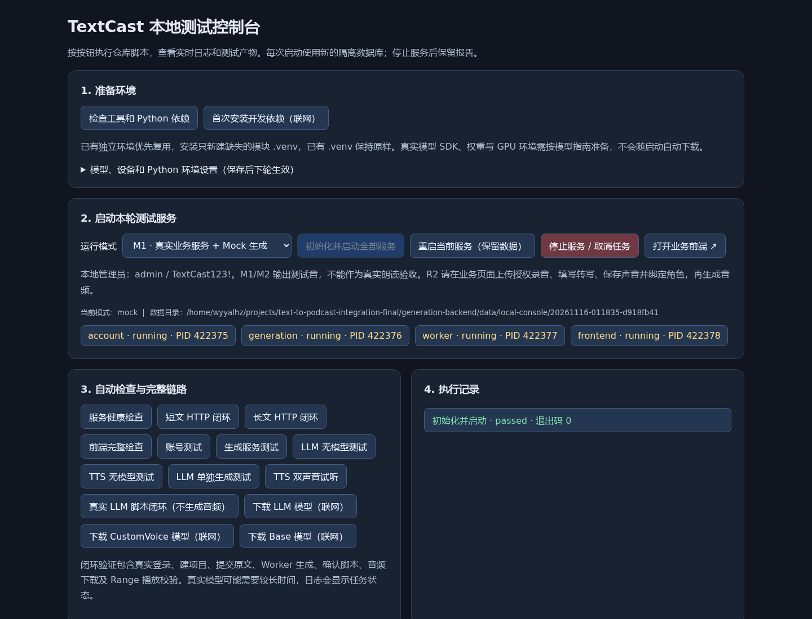
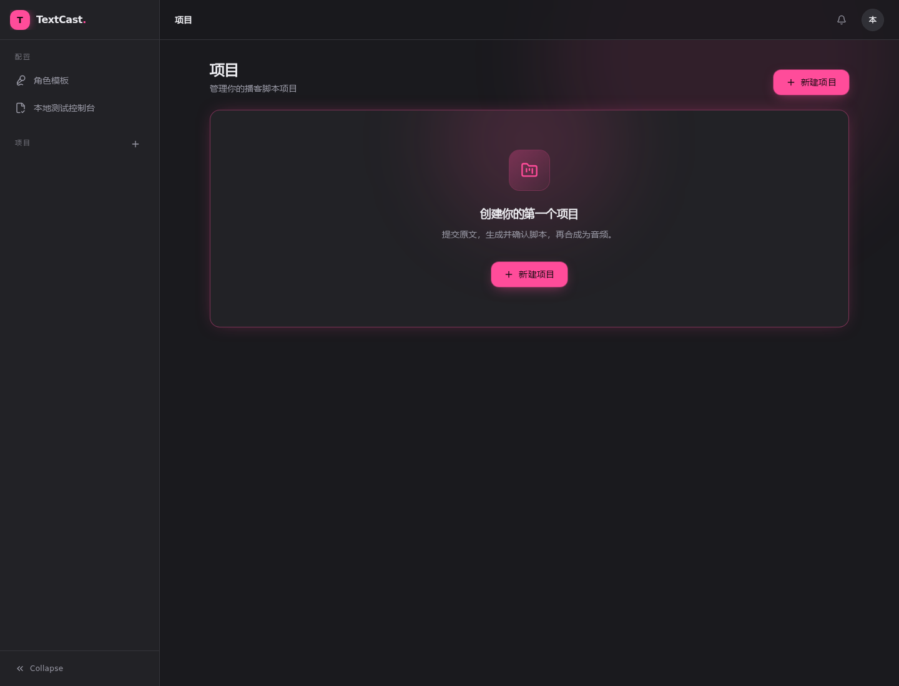

# 浏览器测试控制台

仓库根目录运行一次：

```bash
python scripts/local_console.py
```

随后访问 **http://localhost:8765**。Linux/WSL 也可以执行 `bash start-local.sh`，Windows 可以双击 `start-local.bat`。控制台只需要 Python 3.10+ 标准库；启动本身不要求业务依赖、模型或 Node.js 已安装。浏览器页面不需要登录。

## 操作顺序

1. 点击“检查工具和 Python 依赖”。需要 Node.js ≥22.12、pnpm ≥11。M2 和真实音频模式另需 FFmpeg/FFprobe。
2. 新机器可以点击“首次安装开发依赖（联网）”。只创建缺失的各模块 `.venv` 并安装锁定/声明依赖；已有 `.venv` 保留，失败的本控制台安装可重试。前端执行冻结锁文件安装。模型 SDK/PyTorch 按硬件单独准备，不能用该按钮替代 GPU 环境准备。
3. 在“模型、设备和 Python 环境设置”中填写需要覆盖的绝对路径。留空则自动发现各模块 `.venv`，其次复用既有 Conda 环境，最后使用控制台的 Python。配置文件保存在 Git 忽略目录下。保存前先停止服务及任务。
4. 选择模式，点击“初始化并启动全部服务”，等待启动任务通过。控制台自动迁移新库并启动账号、生成 API、Worker、前端，以及该模式需要的模型服务。
5. 点击“打开业务前端”，访问 http://localhost:5173；测试管理员为 `admin / TextCast123!`。业务前端开发模式侧栏增加了“本地测试控制台”入口，未登录也能访问 `/dev-tools`。
6. 点击健康检查、模块测试或短文/长文 HTTP 闭环按钮，选择执行记录或服务查看输出。日志每约 1.2 秒刷新，可下载当前显示的末尾 64 KiB；完整日志保存在本轮目录中。
7. 闭环成功后，在页面底部打开报告、脚本 JSON，播放或下载音频。点击“停止服务 / 取消任务”停止本控制台启动的进程，保留所有数据库、日志与产物。随后可重新启动新一轮。

更新代码后如要继续当前项目，点击“重启当前服务（保留数据）”，会复用当前数据库和配置；“初始化并启动全部服务”始终创建新一轮。控制台进程本身重开后，也可用 `python scripts/local_console.py --resume generation-backend/data/local-console/<原轮次目录>` 恢复已有一轮。

关闭控制台终端或按 Ctrl+C 也会停止托管进程。不要强制结束控制台进程，否则操作系统可能保留子进程；再次启动如提示端口占用，请关闭原服务。控制台不会根据端口结束其他进程。

## 模式与端口

| 模式 | 启动内容 | 验收边界 |
| --- | --- | --- |
| M1 / mock | 账号 8000、生成 API 8001、Worker、前端 5173 | 真实数据库、审核、队列；固定模拟脚本和测试音 |
| M2 / http-mock | M1 + TTS 8002 | 额外验证 HTTP TTS、WAV、FFmpeg 和 MP3；仍是测试音 |
| R1 / customvoice | M2 + LLM 8003，TTS 使用 CustomVoice | 必须实际推理成功并人工听音、核对脚本后才能验收 |
| R2 / clone | 与 R1 相同，TTS 改用 Base | 在业务声音库上传授权录音、填写转写、保存声音、绑定角色后生成 |

R2 不运行通用短文/长文闭环，因为没有真实参考录音与声音绑定时不能构造有效克隆请求。该按钮会给出操作提示并返回失败，不能把替身结果当成真实克隆通过。克隆的保存、试听与绑定沿用已有业务前端。

如果只需要检查真实 LLM，点击“真实 LLM 脚本闭环（不生成音频）”：使用独立的测试生成库、API 和 Worker 调用当前真实 LLM，不依赖 TTS 录音或声音角色，也不改动当前业务项目。成功后保存脚本和报告，结束时回收临时进程。此按钮适用于 R1/R2，验证范围仅为真实脚本，不代表声音克隆或音频验收通过。

“LLM 单独生成测试”调用现有 LLM 演示脚本；“TTS 双声音试听”调用现有 TTS 演示脚本，输出 WAV 和耗时报告。M1 没有 TTS HTTP 服务，应使用 M2 或 R1 执行 TTS 试听。

三个模型下载按钮均为显式联网任务，可能下载大量文件，不在启动时执行。LLM 沿用仓库已有的固定 revision 下载脚本，写入 `llm/models/Qwen2.5-0.5B-Instruct`，即使页面设置了其他 LLM 路径也不会改写该下载位置。TTS 下载到页面指定的路径或默认 `tts/models/` 对应子目录；HF 缓存支持断点续传。下载使用对应模型 Python 环境，需要其中已安装 huggingface-hub。模型权重下载完成不等于 SDK、GPU 或音质验证完成。

## 终端操作和按钮映射

| 原先手动执行 | 新入口 |
| --- | --- |
| node/pnpm/ffmpeg 版本、Python 依赖检查 | 环境检查 |
| 创建四个环境、安装开发依赖、前端安装 | 首次安装开发依赖 |
| 修改环境变量、启动多个终端、初始化数据库 | 页面设置 + 初始化并启动全部服务 |
| curl 健康/模型资源接口 | 服务健康检查 |
| pytest、unittest、pnpm check | 各模块自动检查按钮 |
| curl 登录、创建项目、提交、轮询、确认、下载 | 短文/长文 HTTP 闭环 |
| LLM/TTS 演示 CLI | 单独生成测试 / 双声音试听 |
| Hugging Face 下载命令 | 三个模型下载按钮 |
| tail 日志、复制输出、找音频 | 实时输出、下载日志、产物播放器 |
| 结束 API、Worker、前端和模型进程 | 停止服务 / 取消任务 |

历史 `tts/scripts/test_melotts.py`、`test_gpt_sovits.py` 等实验不属于当前 Qwen 业务链路，不作为控制台默认服务。系统级 Node.js/FFmpeg/CUDA 驱动安装仍由操作系统负责。详细权限隔离、参考录音负向测试、幂等冲突等复杂验收继续参考 [完整验收流程](acceptance-workflow.md)，自动测试已覆盖其中多项边界。

## 数据与实现

每轮独立保存到 `generation-backend/data/local-console/<时间-随机值>/`，账号与生成数据库、素材、音频、日志均不覆盖既有业务数据。全局执行日志位于 `local-console/jobs/`，页面设置位于 `local-console/settings.json`。这些目录都已被 Git 忽略。测试账号和内部令牌仅用于本地隔离库。

服务只监听 loopback。写接口校验 Host、同源 Origin 和随机令牌；任务有固定白名单，使用参数数组启动进程，不提供任意 shell 执行接口。控制台独立于正式 API，生产构建不包含侧栏入口及 `/dev-tools` 路由，不应把 8765 反向代理到公网。

实现入口：[进程和 HTTP 控制台](../scripts/local_console.py)、[任务脚本](../scripts/local_tasks.py)、[控制台前端](../scripts/console/index.html)。

回归检查：`python -m unittest discover -s scripts/tests -v`。这些测试需要允许监听临时 localhost 端口。

## 实际界面截图

以下截图来自隔离 M1 轮次，浏览器实际完成登录并刷新恢复会话；截图结束后已停止临时服务。





## 硬件检测与 TTS 加速

控制台新增“硬件检测”卡片：异步读取 CPU、WSL/系统内存、磁盘、NVIDIA 显卡/显存/驱动，以及所选 TTS Python 环境中的 PyTorch、CUDA、SDK 和加速包。点击“检测 / 刷新硬件”更新，至少间隔 30 秒，可下载 JSON 报告；检测不会加载模型、下载依赖或修改机器配置。

在“模型、设备和 Python 环境设置”中可以独立选择 TTS 模型规格（0.6B / 1.7B）和后端（standard / faster）。先完成运行中任务，停止服务、保存设置，再点击“重启当前服务（保留数据）”。首次使用 faster 前先停止服务并执行“安装独立 TTS 加速环境”。模型未准备时可用“下载 Qwen TTS 1.7B”按钮。

faster 安装在 `tts/.venv-fast`，复用现有 TTS 环境的 PyTorch/SDK，仅额外固定安装 `faster-qwen3-tts==0.3.0`，不升级 LLM 或普通 TTS 环境。它需要 NVIDIA CUDA；首个请求需要图捕获预热。Base 克隆路径仍使用原有标准后端。模型与加速实测见 [TTS 升级说明](tts-performance-upgrade.md)。
